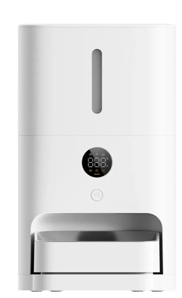

# Xiaomi Smart Pet Feeder for Home Assistant



[](https://hacs.xyz/docs/faq/custom_repositories)

*[Leer en español](README.es.md)*

A native Home Assistant integration for the **Xiaomi Smart Pet Food Feeder 2** (`xiaomi.feeder.iv2001`, and its Chinese twin `xiaomi.feeder.pi2001`).

I wrote this because the generic Xiaomi integrations only got me halfway. Dispensing worked, but "food eaten today" was always 0. The desiccant showed nothing. And after a power cut, the feed button suddenly dispensed 100 g instead of 10.

It turns out the Mi Home app doesn't read those values from the standard MIoT properties at all. It asks a separate Xiaomi service for them. So I pulled apart the app's own plugin (versions 1.0.93 and 1.1.8), checked every request against a real feeder, and rebuilt the same behaviour here. The goal is simple: **whatever the app shows, Home Assistant shows too**.

## What you get

**Sensors**
- **Food eaten today**, in grams. Computed by Xiaomi's cloud, the same number you see in the app.
- **Food left in the bowl**: live bowl weight in grams.
- **Feeding schedule progress**, as a percentage.
- **Status**: one value with the same priority as the app's animation (dispensing, food jam, insufficient food, bowl error, …).
- **Desiccant cartridge**: sufficient, insufficient or run out, plus level and days left.
- **Today's feeding log**: every meal and dispense of the day, in the attributes.

**Alerts** (binary sensors)
- Food jam
- Insufficient food
- Food bowl error
- Low food consumption
- Time to refill
- Weight sensor error
- Food bowl full
- Dispensing
- Backup batteries (disabled by default)

**Controls**
- Dispense button, plus a *Portions to dispense* number (1–15, about 10 g each)
- Switches:
  - Automatic feeding
  - Low food consumption notification
  - Refill reminder
  - Dispensing error correction
  - Food bowl spillage prevention
  - Auto screen-off
  - Child lock
- Numbers: low food intake threshold (10–90 %) and empty food bowl duration (6–12 h)
- Select: what the feeder's screen shows (grams left, grams eaten today, or schedule progress)
- Buttons: weight calibration, dismiss alerts, reset desiccant

**Events and calendar**
- Event entities fire when food is dispensed (with source, result and portions) and when your pet eats (with grams). They make good automation triggers.
- A **Feeding** calendar shows the upcoming schedule and the last 90 days of history.

**Services**

| Service | What it does |
|---|---|
| `xiaomi_pet_feeder.dispense` | Dispense N portions now |
| `xiaomi_pet_feeder.set_schedule` | Replace the whole daily schedule |
| `xiaomi_pet_feeder.add_schedule_entry` / `remove_schedule_entry` | Edit one feeding |
| `xiaomi_pet_feeder.set_schedule_entry_today` | Skip (or restore) one feeding for today only, like the app |
| `xiaomi_pet_feeder.get_schedule` | Return the schedule |
| `xiaomi_pet_feeder.get_feeding_history` | Return meals and dispenses, up to 90 days |
| `xiaomi_pet_feeder.get_hourly_stats` / `get_daily_stats` | The data behind the app's daily and weekly charts |

Schedule edits follow the app's rules: at most 35 feedings, at least 5 minutes apart, 1–15 portions each.

## Installation

### HACS (recommended)

1. In HACS, open **⋮ → Custom repositories**.
2. Add `https://github.com/Cheerpipe/ha-xiaomi-pet-feeder` with the type **Integration**.
3. Install **Xiaomi Smart Pet Feeder** and restart Home Assistant.

### Manual

Copy `custom_components/xiaomi_pet_feeder` into your `config/custom_components` folder and restart.

**Requires Home Assistant 2026.10 or newer.**

## Setup

1. Go to **Settings → Devices & services → Add integration → Xiaomi Smart Pet Feeder**.
2. Pick your **region**. It must match the one in the Xiaomi Home app (*Profile → Settings → Region*). Users in Latin America are usually on `us` or `sg`, and Europe is `de`.
3. Choose how to sign in:
   - **Username and password.** If Xiaomi asks for a captcha or a verification code (e-mail or SMS), the next screen will ask for it.
   - **QR code.** Scan it from the Xiaomi Home app (*Profile* tab → scan icon) and confirm on your phone. Use this if the password login keeps getting rejected; Xiaomi has become picky about it.
4. Select your feeders. Done.

Your password is used once and **never stored**. Home Assistant only keeps the session tokens, and renews them silently when they expire. If renewal fails one day, Home Assistant shows a "re-authenticate" prompt.

## How it works, and its limits

- **It's cloud based, and it polls.**
  - Device status (bowl weight, alerts, settings) is read every **30 seconds**.
  - "Food eaten today" and the feeding log are read every **5 minutes**.
  - The desiccant is read every 6 hours.
  - You can change the first two intervals under the integration's **Configure** button.
- **There is no real-time push.** Xiaomi only offers push to its own official integration. Events (meal, dispense) can therefore show up a few minutes after they happen. Anything you trigger from Home Assistant is refreshed right away.
- **The feeder uploads meals after the pet walks away.** Even the app gets them with a short delay.
- **These are undocumented Xiaomi APIs.** They work today, but Xiaomi can change them without notice. If something breaks, please open an issue with the integration's diagnostics attached. They are already redacted.

## Troubleshooting

- **"No Smart Pet Food Feeder 2 was found"**: the region is wrong. Try the others.
- **Login keeps failing**: use the QR code method.
- **Logs**: to get detailed logs, add this to `configuration.yaml`:
  ```yaml
  logger:
    logs:
      custom_components.xiaomi_pet_feeder: debug
  ```

## Development

```bash
uv venv -p 3.14 && uv pip install -r requirements_test.txt
.venv/bin/pytest
```

The tests replay real responses captured from a feeder (anonymized), covering:
- the login flows
- the RC4 request signing
- every entity
- the services
- the config, reauth and options flows

## Credits

- [@Wh1terat](https://github.com/Wh1terat), for decoding the app's pet feeder API in [al-one/hass-xiaomi-miot#2415](https://github.com/al-one/hass-xiaomi-miot/issues/2415).
- [al-one/hass-xiaomi-miot](https://github.com/al-one/hass-xiaomi-miot) and [PiotrMachowski/Xiaomi-cloud-tokens-extractor](https://github.com/PiotrMachowski/Xiaomi-cloud-tokens-extractor), for years of work on the Xiaomi cloud login.

This project is not affiliated with or endorsed by Xiaomi. "Xiaomi" and "Mi Home" are trademarks of their respective owners.

## License

[MIT](LICENSE)
